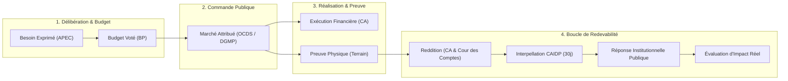

# SuiviBudget Côte d’Ivoire — Roadmap Stratégique & Opérationnelle (Standards Internationaux Civic Tech)

Cette feuille de route aligne **SuiviBudget CI** sur les meilleurs référentiels et méthodologies des Civic Techs mondiales :
- **GIFT** (*Global Initiative for Fiscal Transparency*) : Principes de transparence et participation publique budgétaire.
- **OCP / OCDS** (*Open Contracting Partnership*) : Standard international des données de commande publique (*Open Contracting Data Standard v1.1*).
- **OGP** (*Open Government Partnership*) : Cycle d'engagements mutuels État / Société Civile.
- **TI / mySociety** (*Transparency International / Alaveteli*) : Traçabilité des requêtes FOI/CAIDP et protection des contributeurs.

> **État réel de l'existant :** La plateforme dispose déjà de briques avancées (`src/utils/projectPassport.ts`, `src/components/ProjectAccountabilityPassport.tsx`, `src/components/OfficialDocRequestModal.tsx`, `src/components/SendProofModal.tsx`, `src/components/ApecParticipation.tsx`, `src/utils/budgetCycleEngine.ts`, `src/utils/publicIndicators.ts`). La roadmap ci-dessous complète et standardise l'existant sans réécriture arbitraire. Le plan d'exécution associé figure dans [`docs/IMPLEMENTATION_PLAN_ROADMAP.md`](IMPLEMENTATION_PLAN_ROADMAP.md).

---

## 1. Vue d'Ensemble & Cycle de Redevabilité Fermée (*Closed-Loop Accountability*)

Le standard international refuse l'effet « trou noir » (*Participation Black Hole*). Une contribution citoyenne est reliée à une chaîne auditable complète :

---

## 2. Paliers Opérationnels & Jalons Internationaux

### Jalon 0 — Socle d'Intégrité, Résilience & Sécurité (*Do No Harm & Zero Trust*)
> **Normes de référence :** OWASP Top 10, Loi ivoirienne n° 2013-450 (données personnelles), Intégrité Cryptographique.

- **Acquis intégrés dans le code :**
  - Séparation constitutionnelle État (`1 611,1 Mds FCFA` / 854 projets 2026) vs Collectivités (`195,1 Mds FCFA` / 3 853 projets 2026) via `computePublicIndicators`.
  - Normalisation à 100 % des 8 secteurs budgétaires sans plancher visuel artificiel.
  - Distinction formelle : `PREVISION (BP)` $\neq$ `ENGAGEMENT` $\neq$ `ORDONNANCEMENT` $\neq$ `PAIEMENT (CA)`.
  - Schéma privé Supabase sous RLS strict, durcissement `SECURITY DEFINER`, buckets privés via URLs signées, SHA-256 et pagination contrôlée Cocody CA 2024.
- **Clôture opérationnelle attendue :** Fusion PR #65 / PR #68 et application contrôlée des migrations en production.

---

### Jalon 1 — Traçabilité Bout-en-Bout & Alignement OCDS / GIFT (*Follow The Money*)
> **Normes de référence :** Open Contracting Data Standard (OCDS v1.1), Open Contracting Partnership, GIFT Section 3.

- **Acquis existants :** `ProcurementMatch` (`src/types/administrativeAccount.ts`), rapprochement DGMP et étape `PROCUREMENT_DGMP` dans `projectPassport.ts`.
- **Évolutions d'alignement international :**
  - Standardisation OCDS v1.1 (`src/types/ocds.ts`, `src/utils/ocdsMapper.ts`) attribuant un `ocid` pérenne et exportant les phases `planning`, `tender`, `award`, `contract` et `implementation` sans jamais inventer de montant manquant.
  - Vue comparative synthétique **Voté (BP) ↔ Adjugé (DGMP) ↔ Ordonnancé (CA)** dans `ProjectAccountabilityPassport.tsx`.
  - Extension de la couverture des Budgets Primitifs 2026 de 47 à **100+ collectivités territoriales** avec contrôle humain assermenté.

---

### Jalon 2 — Civic Monitoring & Passeport de Redevabilité (*Evidence-Based Citizen Action*)
> **Normes de référence :** Civic Tech Field Research Protocols, Co-Creation Guidelines OGP, WCAG AA 2.1.

- **Acquis existants :** Composant `ProjectAccountabilityPassport.tsx` (6 étapes), `SendProofModal.tsx` (wizard 3 étapes + `tracking_code` + nettoyage EXIF), `ApecParticipation.tsx`.
- **Évolutions d'alignement international :**
  - Lien canonique direct `/projets?project=<id>&view=passport` ouvrant directement le Passeport de Redevabilité.
  - QR Code imprimable par chantier pour relier les panneaux physiques terrain au Passeport en ligne.
  - Plafond strict de compression photo (`< 300 Ko`) pour zones 2G/3G rurales et règle stricte $\text{Financial Status} \neq \text{Physical Status}$ visible dès les cartes projets.
  - Objectif 2026 : **1 000 observations citoyennes modérées** avec traçabilité des motifs.

---

### Jalon 3 — Interpellation Juridique & Droit de Réponse (*Access to Information & Right of Reply*)
> **Normes de référence :** Alaveteli Standard (mySociety), Loi CAIDP n° 2013-867, Droit de Réponse Équitable.

- **Acquis existants :** Annuaire RI CAIDP (`caidpRiData.ts`), générateur de demandes (`OfficialDocRequestModal.tsx`), journalisation (`CaidpAnalyticsManager.tsx`), schéma `InstitutionResponse`.
- **Évolutions d'alignement international :**
  - **Horloge légale des 30 jours CAIDP** calculée automatiquement à partir des requêtes journalisées (`EN_ATTENTE`, `DELAI_EXPIRE_SAISINE_CAIDP`, `DOC_PUBLIE`).
  - Workflow dédié permettant aux institutions de déposer un droit de réponse sourcé (PV de réception, ordre de service) séparé visuellement des constats citoyens.

---

### Jalon 4 — Inclusion Hors-Ligne, Vulgarisation & Standard Ouvert (*Bridging the Digital Divide*)
> **Normes de référence :** WCAG AA 2.1, FAIR Data Principles.

- **Acquis existants :** Export CSV ouvert (`Footer.tsx`, `BudgetDataDownloads.tsx`), divulgation progressive 3 niveaux.
- **Évolutions d'alignement international :**
  - Générateur **« Budget Citoyen A4 en 1 Page »** optimisé pour impression et affichage en mairie, chefferie, quartier et APEC.
  - Export Open Data étendu au format **OCDS v1.1 (JSON)** aux côtés du CSV existant, accompagné de dictionnaires de champs et empreintes SHA-256.

---

## 3. Indicateurs Clés d'Impact (*Impact > Traffic*)

1. **Taux de bouclage de redevabilité (*Closed-Loop Rate*)** : Part des signalements ou anomalies budgétaires ayant reçu un constat terrain ou une réponse institutionnelle publiée.
2. **Documents publics primaires libérés (*FOI Release Count*)** : Nombre de BP, délibérations et CA publiés après interpellation CAIDP.
3. **Couverture des collectivités avec pièces probantes** : Collectivités sur 232 disposant d'un BP 2026 et d'un CA 2024 certifiés avec concordance patrimoniale.
4. **Divergences financières / physiques détectées** : Opérations mandatées au CA sans achèvement matériel vérifié sur le terrain.
