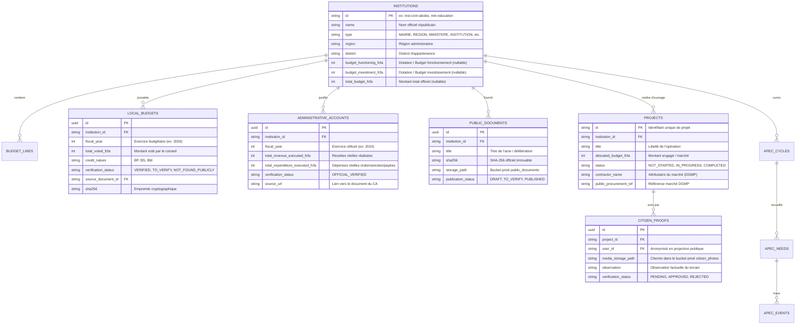

# Modèle de Données & Persistance — SuiviBudget Côte d’Ivoire

Ce document formalise le modèle de données de la plateforme, les entités TypeScript, la structure relationnelle PostgreSQL Supabase, les politiques de sécurité par ligne (RLS) et les principes de conservation immuable des documents officiels.

---

## 1. Vue d'Ensemble & Stratégie Hybride

SuiviBudget CI emploie une architecture de données hybride résiliente :
1. **Socle statique embarqué (`src/data/`) :** Les référentiels légaux officiels (201 communes, 31 régions, 35 ministères, 13 institutions républicaines, régulateurs, catalogues de documents) sont intégrés sous forme d'objets TypeScript typés et gelés. L'application est autonome et pleinement fonctionnelle même sans connectivité base de données.
2. **Couche Supabase dynamique (`cdesuvcozcetdtvibgqs`) :** Stocke les contributions citoyennes, les signalements de chantiers, les votes de priorisation APEC, les versions de documents et les métadonnées soumises à modération humaine.

---

## 2. Modèle Relationnel Supabase & Tables Principales

---

## 3. Politiques de Sécurité par Ligne (RLS) & Droits d'Accès

Le principe de **moindre privilège** régit l'accès à la base Supabase :

| Rôle PostgreSQL | Contexte | Droits Accordés | Restrictions |
|---|---|---|---|
| `anon` (Citoyen non authentifié) | Navigation publique sur le web | `SELECT` strict sur les tables et vues marquées `PUBLISHED` ou `APPROVED` | Aucun `INSERT`, `UPDATE`, `DELETE`. Données personnelles masquées |
| `authenticated` (Citoyen connecté) | Soumission de besoin APEC ou signalement terrain | `INSERT` sur `apec_needs` et `citizen_proofs` (avec statut initial `PENDING` ou `TO_VERIFY`) | Lecture limitée à ses propres soumissions et aux données publiques |
| `MODERATOR` | Revue civique | `SELECT` et `UPDATE` sur les preuves et besoins (`PENDING` -> `APPROVED` / `REJECTED`) | Aucune modification des dotations officielles LFI |
| `DATA_MANAGER` | Gestionnaire de données | `INSERT` / `UPDATE` contrôlés via l'interface d'import staging | Validation obligatoire des empreintes SHA-256 |
| `ADMIN` | Responsable plateforme | Supervision globale et gestion des droits | Rôle vérifié côté serveur par `profiles.role = 'ADMIN'`, jamais par `user_metadata` |

### Guard Anti-Élévation de Privilège Client
Le client web ([supabase.ts](../../src/services/supabase.ts)) contient un intercepteur strict empêchant l'exécution si une clé de rôle administrateur ou `service_role` est détectée dans les variables Vite (`import.meta.env`).

---

## 4. Stockage des Pièces Jointes & Buckets Privés

La plateforme utilise deux buckets Supabase Storage configurés en mode **strictement privé** :
1. `public_documents` : Actes officiels, délibérations scannées, lois de finances et rapports de la Cour des Comptes.
2. `citizen_photos` : Photographies et pièces justificatives transmises par les observateurs citoyens.

### Règles d'accès et d'intégrité :
- **Immutabilité :** Téléversement configuré avec `upsert: false`. Une délibération ou un document officiel ne peut jamais être écrasé.
- **Empreinte SHA-256 :** L'empreinte cryptographique est calculée avant le stockage et enregistrée dans la table `public_documents`.
- **Signature temporaire :** L'accès citoyen aux fichiers publiés s'effectue exclusivement par des URLs signées à durée limitée (générées par les Edge Functions `public-document-url` et `citizen-proof-media-url`).

---

## 5. Distinction Données Statiques vs Données Supabase

| Entité | Source Principale | Justification Technique |
|---|---|---|
| **Lois de Finances (LFI 2026, Annexes 7 & 10)** | `src/data/nationalBudgetData.ts` | Données républicaines stables votées par le Parlement, ne devant subir aucune modification dynamique. |
| **Périmètre des 232 Collectivités** | `src/data/officialDataFromCsv.ts` | Découpage administratif officiel de la République de Côte d'Ivoire. |
| **Marchés Publics DGMP & Marchés Stratégiques** | `src/data/budgetLinesData.ts` | Référentiel audité des avis d'attribution et montants contractuels. |
| **Signalements de Chantiers Citoyens** | Supabase `citizen_proofs` | Flux contributif en temps réel nécessitant modération. |
| **Demandes d'accès à l'information (CAIDP)** | Modale citoyenne locale / Supabase | Générateur conforme à la Loi n°2013-867. |

---

## 6. Précautions & Règles pour les Migrations

> [!IMPORTANT]
> - **Règle absolue :** `REMOTE_SUPABASE_WRITES = 0` dans les sessions d'audit, de test et de maintenance frontend.
> - Aucune migration ne doit être exécutée directement contre la base de production sans validation de sécurité et examen des politiques RLS.
> - Ne jamais insérer de données de test ou de délibérations fictives dans les tables publiques.
