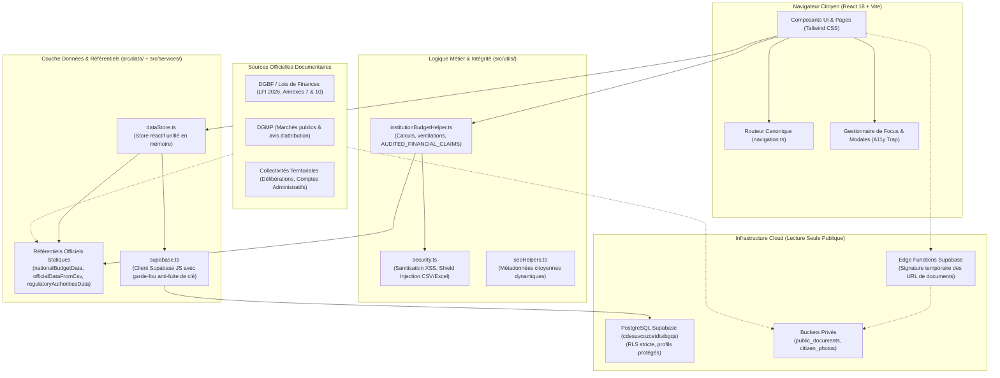
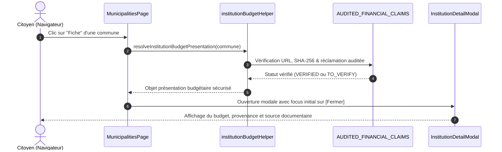
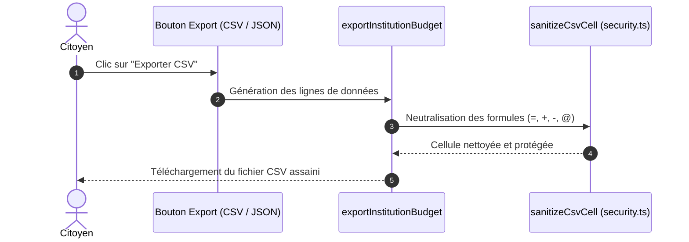

# Architecture Globale — SuiviBudget Côte d’Ivoire

Ce document présente l'organisation architecturale globale de la plateforme SuiviBudget Côte d’Ivoire, les responsabilités de chaque module, le cycle de vie des données et les points d'extension du système.

---

## 1. Schéma d'Architecture Général

---

## 2. Modules et Responsabilités

### A. Présentation & Expérience Utilisateur (`src/components/`, `src/pages/`)
- **Code splitting automatique :** Les pages volumineuses (`InstitutionsPage`, `ProjectsPage`, `DocumentsPage`, `ObservatoryPage`, `AdminDashboardPage`) sont chargées paresseusement (`lazy()`) via Vite pour maintenir un premier rendu ultra-rapide (< 100 ms).
- **Accessibilité & Focus Trap :**
  - La modale institutionnelle ([InstitutionDetailModal.tsx](../../src/components/InstitutionDetailModal.tsx)) implémente un piégeage de focus circulaire étanche (`Shift+Tab` et `Tab`) filtrant récursivement les éléments masqués par le CSS responsive (`checkVisibility`, classes Tailwind).
  - Les modales filles ([OfficialDocRequestModal.tsx](../../src/components/OfficialDocRequestModal.tsx)) interceptent la touche `Escape` via `e.stopPropagation()` pour éviter la double fermeture et restaurent le focus directement sur le bouton déclencheur.
- **Conformité responsive :** Prise en charge sans débordement horizontal (`overflow-x`) des viewports smartphones (360, 390, 430 px), tablettes (768, 1024 px) et desktop (1440, 1920 px).

### B. Moteur Budgétaire & Barrière d'Intégrité (`src/utils/institutionBudgetHelper.ts`)
- **Isolation des statuts de vérification :** Tout chiffre est qualifié selon 4 états :
  - `VERIFIED` : Chiffre audité avec document officiel, page exacte et empreinte SHA-256 dans `AUDITED_FINANCIAL_CLAIMS`.
  - `TO_VERIFY` : Chiffre issu d'une source secondaire (presse officielle, AIP, Fraternité Matin) nécessitant la délibération originale avant certification.
  - `UNAUDITED_DELIBERATION` : Délibération brute non auditée (aucun montant certifié).
  - `NOT_FOUND_PUBLICLY` : Absence temporaire de document affichée comme *« Non documenté »*.
- **Règle `UNKNOWN ≠ 0` :** Les données non disponibles ne sont jamais converties en zéros.
- **Ventilation conditionnelle :** Pour les budgets équilibrés non certifiés (`TO_VERIFY`), les montants de fonctionnement et d'investissement bruts sont conservés, mais les pourcentages calculés restent à `null` pour interdire toute sur-interprétation graphique.

### C. Référentiels Officiels Statiques (`src/data/`)
- L'application intègre des référentiels structurés immuables, garantissant que l'application fonctionne même hors connexion ou en cas de coupure du backend Supabase :
  - `nationalBudgetData.ts` : 35 ministères, 13 grandes institutions de la République (sections LOLF, programmes).
  - `officialDataFromCsv.ts` : 201 communes et 31 conseils régionaux de Côte d'Ivoire.
  - `regulatoryAuthoritiesData.ts` : Organes et autorités indépendantes de régulation (ANRMP, ARTCI, etc.).
  - `officialPublicDocumentsCatalog.ts` : Index des PDF officiels (LFI 2026, délibérations, arrêtés).

### D. Couche de Persistance & Connecteur Supabase (`src/services/`)
- **`dataStore.ts` :** Implémente le pattern Singleton réactif avec observateur (`subscribe`). Il combine les jeux de données statiques officiels avec les flux dynamiques provenant de Supabase.
- **`supabase.ts` :** Client encapsulé avec validation d'empreinte de sécurité. Toute tentative d'injection d'une clé de service administrative (`service_role`) dans les variables d'environnement client déclenche une exception bloquante au démarrage.

---

## 3. Flux de Données

### Consultation d'une Fiche Institutionnelle

### Export Open Data Sécurisé

---

## 4. Points d'Extension pour Nouvelles Fonctionnalités

1. **Ajout d'une nouvelle institution ou autorité publique :**
   - Modifier `src/data/nationalBudgetData.ts` ou `src/data/regulatoryAuthoritiesData.ts`.
   - Renseigner impérativement les métadonnées officielles (`name`, `code`, `ministere_tutelle`, `base_legale`, `budget_2026`).
2. **Ajout d'une dotation ou d'un chiffre budgétaire audité :**
   - Compléter `AUDITED_FINANCIAL_CLAIMS` dans `src/utils/institutionBudgetHelper.ts` avec la référence textuelle exacte, l'action LOLF, le montant en FCFA et l'empreinte SHA-256 du document officiel.
3. **Ajout de nouveaux types de documents dans la bibliothèque :**
   - Ajouter l'entrée correspondante dans `src/data/officialPublicDocumentsCatalog.ts`.
   - Déclarer son SHA-256 et son URL pérenne de consultation.
4. **Ajout d'un test d'intégrité financière :**
   - Créer un fichier de test dans `src/utils/__tests__/` exécuté automatiquement par `npm test`.
