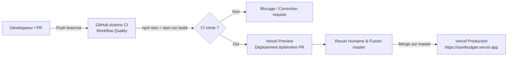

# Guide de Déploiement & Gestion des Versions (DEPLOYMENT)

Ce document décrit le pipeline d'intégration continue GitHub Actions, la configuration du déploiement continu Vercel, la vérification du SHA en production et les stratégies de retour arrière.

---

## 1. Vue d'Ensemble du Pipeline CI/CD



---

## 2. Intégration Continue (GitHub Actions)

Le workflow de qualité est défini dans `.github/workflows/ci.yml` :
- **Déclencheurs :** Tout `push` sur la branche `master` et toute `pull_request`.
- **Environnement d'exécution :** `ubuntu-latest`, Node.js 22 LTS.
- **Étapes automatisées :**
  1. `npm ci --ignore-scripts` : Installation propre et déterministe basée sur `package-lock.json`.
  2. `npm test` : Exécution complète des 59 suites Vitest (778 tests).
  3. `npm run build` : Compilation TypeScript (`tsc`) et packaging Vite standard.
  4. `npm run build:review` : Compilation de la configuration de revue documentaire.

> [!IMPORTANT]
> **Règle de gouvernance :** Aucune PR ne peut être fusionnée dans `master` sans un job `verify` strictement réussi (vert).

---

## 3. Déploiement sur Vercel

### A. Configuration du Projet
- **Framework Preset :** Vite.
- **Build Command :** `npm run build` (ou script par défaut Vite).
- **Output Directory :** `dist`.
- **Install Command :** `npm install` (avec respect des `overrides` de `package.json`).
- **Production Branch :** `master`.

### B. Variables d'Environnement sur Vercel
Dans les paramètres du projet Vercel (**Settings** > **Environment Variables**) :
- `VITE_SUPABASE_URL` : URL de production Supabase (`https://cdesuvcozcetdtvibgqs.supabase.co`).
- `VITE_SUPABASE_ANON_KEY` : Clé publique anonyme (`anon`).

> [!CAUTION]
> Ne configurez **jamais** la clé `SUPABASE_SERVICE_ROLE_KEY` dans les variables d'environnement Vercel du projet frontend.

---

## 4. Vérification et Rapprochement du SHA Déployé

Pour garantir qu'un commit fusionné sur `master` est effectivement servi aux citoyens :

### Étape 1 : Obtenir le SHA de la branche `master`
```bash
git rev-parse HEAD
# Exemple : 18dba91f6098d40d150506476ea3e4dc8ce94e5c
```

### Étape 2 : Vérifier le statut du déploiement via GitHub API
```bash
gh api "repos/jeananvoh-cmyk/suivibudget-ci/deployments?environment=Production&per_page=1"
```
Recherchez le champ `sha` correspondant exactement à celui de `master` et notez son identifiant de déploiement (ex: `7034805135`).

Vérifiez le statut de ce déploiement :
```bash
gh api repos/jeananvoh-cmyk/suivibudget-ci/deployments/<DEPLOYMENT_ID>/statuses
```
Le champ `state` doit valoir `"success"` avec `description: "Deployment has completed"`.

### Étape 3 : Contrôler les Chunks Servis sur le Domaine Public
Pour vérifier que les bundles servis sur `https://suivibudget.vercel.app/` contiennent les marqueurs du commit sans problème de cache navigateur ou CDN :
```bash
# Vérifier l'en-tête ETag et l'absence de cache persistant
curl -sI https://suivibudget.vercel.app/ | grep -E "HTTP|ETag|x-vercel"
```

---

## 5. Gestion des Quotas & Bonnes Pratiques

- **Éviter les builds répétitifs inutiles :** Ne déclenchez pas de redéploiements multiples à chaque commit mineur de documentation. Regroupez les commits avant de pousser la branche.
- **Concurrence gérée :** Le workflow GitHub Actions active `cancel-in-progress: true` (`concurrency: group: quality-${{ github.ref }}`) pour annuler automatiquement les builds obsolètes si de nouveaux commits sont poussés rapidement.
- **Règle budgétaire Vercel :** En cas d'avertissement de quota atteint, ne jamais souscrire à un abonnement payant sans autorisation explicite du propriétaire du projet. Documenter le statut et attendre la réinitialisation du cycle.

---

## 6. Procédure de Rollback

En cas d'anomalie critique en production :

### Rollback Vercel (instantané, < 10 secondes)
1. Ouvrez `https://vercel.com/jeananvoh-8596s-projects/suivibudget-ci/deployments`.
2. Repérez le déploiement antérieur validé.
3. Cliquez sur le menu contextuel `...` > **Promote to Production**.
4. Le domaine `suivibudget.vercel.app` pointe immédiatement sur l'ancien build sain.

### Rollback Git (alignement du code source)
Une fois le rollback Vercel actif, alignez le dépôt Git :
```bash
git checkout master
git pull origin master
git revert <COMMIT_SHA_A_ANNULER> -m 1
git push origin master
```
Ceci assure que le prochain déploiement continu reste cohérent avec l'état de production.
