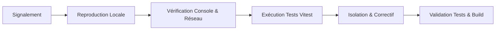

# Runbook d’Exploitation & Guide de Dépannage (RUNBOOK)

## Dashboard admin : sauvegarde, restauration et contrat différé

La correction `codex/admin-dashboard-persistence-hardening` reste non déployée. Son contrat serveur version 2, la migration `20261013165625_admin_dashboard_persistence_hardening.sql` et les fonctions Edge `admin-media-url` / `public-document-url` doivent être approuvés et testés ensemble avant tout frontend correspondant. Attendre la fusion ou fermeture de la PR #62 avant la PR corrective. Le [rapport de sécurité](../audits/admin/ADMIN_DASHBOARD_SECURITY_REMEDIATION.md) détaille la recette bloquée et l'ordre migration, Edge, frontend.

Le contrat 2 cloisonne les journaux par domaine et conserve les reçus d'opération atomiques. La lecture directe admin_media est refusée ; les signatures sont bornées à 60 secondes, sans révocation instantanée des liens déjà émis. Les six métadonnées documentaires sont additives ; une empreinte reste DECLARED jusqu'au contrôle serveur des octets, sans qualification humaine automatique. En incident, bloquer les mutations affectées et conserver reçus, audit, attestations, originaux et historiques ; ne pas restaurer une policy permissive, supprimer les colonnes ou certifier Cocody pour réparer un accès.

L’export JSON du dashboard est une copie locale de cache. Il ne contient ni toutes les tables PostgreSQL, ni Auth, ni les fichiers privés. Une sauvegarde de base Supabase contient les métadonnées Storage, pas les fichiers eux-mêmes. [Documentation Supabase sur les sauvegardes](https://supabase.com/docs/guides/platform/backups).

### Préparer une sauvegarde opérateur

1. Relever les SHAs, la version PostgreSQL, les migrations appliquées, extensions, rôles et ACL/RLS. Conserver un inventaire des tables, volumes, statuts, versions et sommes financières qualifiées. Ne pas afficher les secrets dans des logs ; utiliser un service libpq protégé ou le gestionnaire de secrets de l’exploitant.
2. Définir une fenêtre cohérente DB/Storage et suspendre les écritures administratives pendant la capture si nécessaire. Produire une archive PostgreSQL chiffrée et une copie distincte des fichiers des buckets privés autorisés. Ne pas réutiliser les identifiants de production dans un navigateur de recette.
3. Avec un client PostgreSQL compatible, l’exemple ci-dessous lit la base via un service libpq configuré par l’opérateur ; il n’a pas été exécuté sur la production par Codex :

   ```powershell
   $env:PGSERVICE = 'suivibudget_backup_readonly'
   pg_dump --format=custom --file=work/suivibudget-postgres.dump
   if ($LASTEXITCODE -ne 0) { throw 'Sauvegarde PostgreSQL échouée' }
   pg_restore --list work/suivibudget-postgres.dump > work/restore-toc.txt
   Get-FileHash -Algorithm SHA256 -LiteralPath work/suivibudget-postgres.dump
   ```

   Le format custom permet l’inventaire et la restauration sélective. [Documentation PostgreSQL de pg_dump](https://www.postgresql.org/docs/current/app-pgdump.html).

4. Exporter séparément les objets par API Storage/S3 autorisée : bucket, chemin complet, version, octets et SHA-256 du fichier téléchargé. Copier les paramètres des buckets et leurs politiques. Ne pas utiliser des URL signées expirantes comme fichiers de sauvegarde ; ne pas rendre un bucket public pour exporter. [Téléchargement des objets Supabase](https://supabase.com/docs/guides/storage/management/download-objects).
5. Chiffrer les archives et manifestes, limiter leurs droits d’accès, conserver la clé de restauration séparément. Comparer le manifeste aux références `public_documents`, pièces jointes et photos. Une différence de taille/hash ou un objet absent bloque la qualification de la sauvegarde.

### Recette de restauration isolée

1. Choisir un projet de recette autorisé ou une instance locale avec rôles, extensions et schémas Supabase compatibles. Vérifier explicitement son identifiant et son endpoint ; bloquer tout egress vers la production. Les sauvegardes peuvent contenir des données privées : limiter l’accès et neutraliser courriels, cron, webhooks et fonctions sortantes avant toute utilisation.
2. Relire le TOC de l’archive et les contraintes des schémas gérés. Pour un projet Supabase déjà initialisé, utiliser la procédure officielle de [sauvegarde/restauration Supabase](https://supabase.com/docs/guides/platform/migrating-within-supabase/backup-restore), avec la version de CLI validée par l’exploitant. Ne pas appliquer aveuglément un dump intégral sur les schémas Auth/Storage existants.
3. Sur une base PostgreSQL isolée vide préparée avec les prérequis compatibles, la restauration peut être atomique et arrêtée à la première erreur :

   ```powershell
   $env:PGSERVICE = 'suivibudget_isolated_restore'
   pg_restore --dbname=service=suivibudget_isolated_restore --exit-on-error --single-transaction --no-owner work/suivibudget-postgres.dump
   if ($LASTEXITCODE -ne 0) { throw 'Restauration isolée échouée : ne pas poursuivre' }
   ```

   Aucune restauration concurrente `--jobs` n’est combinée à `--single-transaction`. [Documentation PostgreSQL de pg_restore](https://www.postgresql.org/docs/current/app-pgrestore.html).

4. Restaurer les blobs avec l’API Storage dans les buckets privés de recette. Les lignes `storage.objects` seules ne recréent pas les octets. Sur un service Storage initialisé, préparer l’import des métadonnées avec la procédure Supabase afin de ne pas entrer en conflit avec les objets que l’API recrée ; conserver les chemins référencés et rapprocher les propriétaires autorisés. Ne pas écrire directement dans les tables Storage pour simuler une restauration de fichiers.
5. Vérifier counts, FK, révisions, versions, statuts et hashes des fichiers ; vérifier la lecture des fichiers privés, les refus anon/citoyen, les rôles staff, la file, le journal, les montants historiques et UNKNOWN ≠ 0. Tester deux sessions, réponse perdue, publication/dépublication et retrait de source. La copie de Cocody 2024 demeure TO_VERIFY sans examen humain réel.
6. Signer le procès-verbal de recette avec les anomalies et le temps de reprise. Cette mission a testé une sauvegarde/restauration **PGlite isolée** ; elle n’a pas exécuté cette procédure PostgreSQL/Storage avec un dump de production. Ne pas la déclarer validée sans exercice opérateur.

### Retour arrière du contrat admin

Bloquer les mutations administratives et préserver les lignes, événements et objets ajoutés. Un retour frontend ne doit pas réactiver les anciennes fausses sauvegardes locales : garder le dashboard indisponible jusqu’à un frontend compatible. Les pages publiques peuvent revenir au déploiement stable après validation.

Conserver les tables et colonnes additives ; ne pas supprimer le journal ou les nouvelles versions. Ne rétablir NOT NULL sur les montants que si aucune ligne inconnue n’existe. Préparer le retour des ACL/RLS à partir de la capture antérieure et le tester isolément. Un rollback de politiques n’est pas une restauration de données. Toute intervention distante et toute promotion de production demandent une validation explicite du responsable.

En cas de sauvegarde confirmée mais relecture indisponible, réessayer le même formulaire sans modifier son contenu. En cas de conflit de révision, conserver la saisie, recharger la version serveur puis comparer les deux versions. Ne jamais contourner RLS ni forcer une révision pour faire disparaître le conflit.

Ce runbook fournit aux développeurs et exploitants les procédures opérationnelles pour diagnostiquer, isoler et résoudre les incidents sur la plateforme SuiviBudget Côte d’Ivoire.

---

## 1. Procédure Générale de Diagnostic

Lorsqu'une anomalie est signalée, suivez systématiquement cet ordre méthodologique :



### Étape 1 : Inspection Console & Réseau
1. Ouvrez les DevTools du navigateur (`F12`).
2. Vérifiez la présence d'erreurs JavaScript dans l'onglet **Console** :
   - `TypeError`, `Uncaught Exception`, avertissements d'accessibilité.
3. Vérifiez l'onglet **Réseau** (Network) :
   - Requêtes Supabase (`/rest/v1/...`) : code HTTP 200 vs 401/403 (problème de droits RLS) ou 404 (ressource inexistante).
   - Chargement des chunks JS (`/assets/*.js`) : code HTTP 200 vs 404/302.

### Étape 2 : Contrôle des Types TypeScript
Exécutez la vérification statique sans build :
```bash
npx tsc --noEmit
```
Si des erreurs apparaissent, corrigez-les en priorité. Le build de production échoue si une seule erreur de type subsiste.

### Étape 3 : Exécution de la Suite de Tests Automatisée
Exécutez l'ensemble des tests pour détecter toute régression :
```bash
npm test
```

---

## 2. Exécution de Tests Ciblés

Pour accélérer le diagnostic d'un composant ou d'une règle métier spécifique, lancez uniquement le test correspondant :

| Domaine à tester | Commande ciblée |
|---|---|
| **Accessibilité Modale & Focus Trap** | `npx vitest run src/components/__tests__/institutionDetailModalFocusTrap.test.ts` |
| **Barrière d'Intégrité & Claims Budgétaires** | `npx vitest run src/utils/__tests__/budgetBreakdownIntegrityGate.test.ts` |
| **Intégrité des Budgets Locaux & Règle `UNKNOWN ≠ 0`** | `npx vitest run src/utils/__tests__/financialIntegrity.test.ts` |
| **Sécurité XSS & Injection Formules CSV** | `npx vitest run src/utils/__tests__/security.test.ts` |
| **Rapprochement Budgétaire Ministériel** | `npx vitest run src/utils/__tests__/institutionReconciliationE2E.test.ts` |
| **Passeport de Projets & Étancheité Physique** | `npx vitest run src/utils/__tests__/institutionProjects.test.ts` |

---

## 3. Fiches de Résolution d'Incidents Courants

### Incident A : Le focus clavier s'échappe de la modale sur mobile (< 640 px)
- **Symptôme :** En appuyant sur `Shift+Tab` immédiatement après l'ouverture de la modale sur smartphone, le focus quitte la boîte de dialogue et se perd sur la page arrière-plan.
- **Cause racine :** Des éléments de l'en-tête portent des classes responsive Tailwind (ex: `hidden sm:inline-flex` pour les liens site web ou Facebook). Dans le DOM, ces éléments existent mais ont `display: none` calculé. Un sélecteur de focus standard les récupère s'il ne teste pas la visibilité calculée.
- **Résolution :**
  - Utiliser la fonction utilitaire `isElementEffectivelyVisible(el, container)` définie dans [InstitutionDetailModal.tsx](../../src/components/InstitutionDetailModal.tsx).
  - Cette fonction combine `checkVisibility({ checkVisibilityCSS: true })` et un parcours ascendant du DOM pour exclure tout élément masqué par Tailwind.
  - Vérifier avec le test : `npx vitest run src/components/__tests__/institutionDetailModalFocusTrap.test.ts`.

### Incident B : La modale parente se ferme en même temps que la modale fille (CAIDP)
- **Symptôme :** L'utilisateur ouvre la modale institutionnelle, clique sur « Demande CAIDP », puis appuie sur `Escape` : les deux modales se ferment brutalement d'un coup.
- **Cause racine :** L'événement clavier `Escape` bouillonne (`bubbles`) depuis la modale fille vers le gestionnaire global de la modale parente.
- **Résolution :**
  - Dans la modale fille ([OfficialDocRequestModal.tsx](../../src/components/OfficialDocRequestModal.tsx)), intercepter la touche `Escape` :
    ```typescript
    if (e.key === 'Escape') {
      e.preventDefault();
      e.stopPropagation();
      onClose();
    }
    ```
  - Dans le composant parent, mémoriser la référence du bouton déclencheur (`triggerRef`) pour restaurer le focus exact lors de la fermeture de l'enfant.

### Incident C : Un montant non documenté s'affiche comme « 0 FCFA »
- **Symptôme :** Une commune ou un conseil régional sans délibération officielle affiche un budget de `0 FCFA`.
- **Cause racine :** Violation de l'Invariant 1 (`UNKNOWN ≠ 0`). Une valeur `null` ou `undefined` a été forcée à `0` via un opérateur de repli (`|| 0` ou `?? 0`).
- **Résolution :**
  - Remplacer le formateur par la fonction officielle `formatFcfaAmount(amount)` ou `getInstitutionBudgetPresentation()`.
  - Si `amount === null`, retourner explicitement `'Non documenté'` ou masquer la ligne.
  - Lancer le test d'intégrité : `npx vitest run src/utils/__tests__/financialIntegrity.test.ts`.

### Incident D : Erreur de build Vite — Chunks volumineux (> 1200 kB)
- **Symptôme :** Lors de `npm run build`, Vite affiche un avertissement de dépassement de taille sur `data-budgetlines-*.js` ou `data-projects-*.js`.
- **Cause racine :** Les référentiels de données volumineuses (milliers de lignes budgétaires ou projets) sont groupés dans des fichiers statiques.
- **Résolution :**
  - Le fractionnement (`code-splitting`) dans `vite.config.ts` isole déjà ces données sous forme de chunks autonomes (`data-budgetlines`, `data-projects`, `data-institutions`).
  - S'assurer que les pages qui consomment ces jeux de données utilisent l'import dynamique `lazy()` :
    ```typescript
    const ProjectsPage = lazy(() => import('./pages/ProjectsPage').then(m => ({ default: m.ProjectsPage })));
    ```

### Incident E : Erreur Supabase 403 / Problème d'accès RLS
- **Symptôme :** Une requête vers Supabase échoue avec un code HTTP 403 Forbidden.
- **Cause racine :** La table cible applique la RLS (Row Level Security) et aucune politique n'autorise le rôle `anon` en lecture sur les lignes demandées (par exemple, si le statut n'est pas `PUBLISHED` ou `APPROVED`).
- **Vérification :**
  - Seules les données validées par les modérateurs sont accessibles publiquement.
  - Ne jamais désactiver la RLS (`ALTER TABLE ... DISABLE ROW LEVEL SECURITY` est strictement proscrit).

---

## 4. Procédure d'Escalade & Retour Arrière (Rollback)

Si un déploiement en production introduit une régression critique bloquante :

### Option 1 : Rollback Instantané Vercel (Recommandé en urgence)
1. Accédez à la console Vercel du projet : `https://vercel.com/jeananvoh-8596s-projects/suivibudget-ci`.
2. Ouvrez l'onglet **Deployments**.
3. Repérez le dernier déploiement stable précédent (ex: SHA `18dba91f6098d40d150506476ea3e4dc8ce94e5c`).
4. Cliquez sur les trois points `...` à droite et sélectionnez **Promote to Production**.
5. Le trafic est redirigé immédiatement vers la version saine sans délai de compilation.

### Option 2 : Revert Git & Déploiement CI
1. Sur une branche de secours locale :
   ```bash
   git checkout master
   git pull origin master
   git revert <SHA_DU_COMMIT_FAUTIF> -m 1
   git push origin master
   ```
2. GitHub Actions exécute le job de vérification `verify`.
3. Vercel déploie automatiquement le commit de retour arrière sur `master`.
