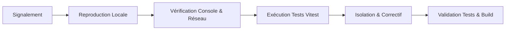

# Runbook d’Exploitation & Guide de Dépannage (RUNBOOK)

Ce runbook fournit aux développeurs et exploitants les procédures opérationnelles pour diagnostiquer, isoler et résoudre les incidents sur la plateforme SuiviBudget Côte d’Ivoire.

---

## 1. Procédure Générale de Diagnostic

Lorsqu'une anomalie est signalée, suivez systématiquement cet ordre méthodologique :



### Étape 1 : Inspection Console & Réseau
1. Ouvrez les DevTools du navigateur (`F12`).
2. Vérifiez la présence d'erreurs JavaScript dans l'onglet **Console** :
   - `TypeError`, `Uncaught Exception`, avertissements d'accessibilité.
3. Vérifiez l'onglet **Réseau** (Network) :
   - Requêtes Supabase (`/rest/v1/...`) : code HTTP 200 vs 401/403 (problème de droits RLS) ou 404 (ressource inexistante).
   - Chargement des chunks JS (`/assets/*.js`) : code HTTP 200 vs 404/302.

### Étape 2 : Contrôle des Types TypeScript
Exécutez la vérification statique sans build :
```bash
npx tsc --noEmit
```
Si des erreurs apparaissent, corrigez-les en priorité. Le build de production échoue si une seule erreur de type subsiste.

### Étape 3 : Exécution de la Suite de Tests Automatisée
Exécutez l'ensemble des tests pour détecter toute régression :
```bash
npm test
```

---

## 2. Exécution de Tests Ciblés

Pour accélérer le diagnostic d'un composant ou d'une règle métier spécifique, lancez uniquement le test correspondant :

| Domaine à tester | Commande ciblée |
|---|---|
| **Accessibilité Modale & Focus Trap** | `npx vitest run src/components/__tests__/institutionDetailModalFocusTrap.test.ts` |
| **Barrière d'Intégrité & Claims Budgétaires** | `npx vitest run src/utils/__tests__/budgetBreakdownIntegrityGate.test.ts` |
| **Intégrité des Budgets Locaux & Règle `UNKNOWN ≠ 0`** | `npx vitest run src/utils/__tests__/financialIntegrity.test.ts` |
| **Sécurité XSS & Injection Formules CSV** | `npx vitest run src/utils/__tests__/security.test.ts` |
| **Rapprochement Budgétaire Ministériel** | `npx vitest run src/utils/__tests__/institutionReconciliationE2E.test.ts` |
| **Passeport de Projets & Étancheité Physique** | `npx vitest run src/utils/__tests__/institutionProjects.test.ts` |

---

## 3. Fiches de Résolution d'Incidents Courants

### Incident A : Le focus clavier s'échappe de la modale sur mobile (< 640 px)
- **Symptôme :** En appuyant sur `Shift+Tab` immédiatement après l'ouverture de la modale sur smartphone, le focus quitte la boîte de dialogue et se perd sur la page arrière-plan.
- **Cause racine :** Des éléments de l'en-tête portent des classes responsive Tailwind (ex: `hidden sm:inline-flex` pour les liens site web ou Facebook). Dans le DOM, ces éléments existent mais ont `display: none` calculé. Un sélecteur de focus standard les récupère s'il ne teste pas la visibilité calculée.
- **Résolution :**
  - Utiliser la fonction utilitaire `isElementEffectivelyVisible(el, container)` définie dans [InstitutionDetailModal.tsx](../../src/components/InstitutionDetailModal.tsx).
  - Cette fonction combine `checkVisibility({ checkVisibilityCSS: true })` et un parcours ascendant du DOM pour exclure tout élément masqué par Tailwind.
  - Vérifier avec le test : `npx vitest run src/components/__tests__/institutionDetailModalFocusTrap.test.ts`.

### Incident B : La modale parente se ferme en même temps que la modale fille (CAIDP)
- **Symptôme :** L'utilisateur ouvre la modale institutionnelle, clique sur « Demande CAIDP », puis appuie sur `Escape` : les deux modales se ferment brutalement d'un coup.
- **Cause racine :** L'événement clavier `Escape` bouillonne (`bubbles`) depuis la modale fille vers le gestionnaire global de la modale parente.
- **Résolution :**
  - Dans la modale fille ([OfficialDocRequestModal.tsx](../../src/components/OfficialDocRequestModal.tsx)), intercepter la touche `Escape` :
    ```typescript
    if (e.key === 'Escape') {
      e.preventDefault();
      e.stopPropagation();
      onClose();
    }
    ```
  - Dans le composant parent, mémoriser la référence du bouton déclencheur (`triggerRef`) pour restaurer le focus exact lors de la fermeture de l'enfant.

### Incident C : Un montant non documenté s'affiche comme « 0 FCFA »
- **Symptôme :** Une commune ou un conseil régional sans délibération officielle affiche un budget de `0 FCFA`.
- **Cause racine :** Violation de l'Invariant 1 (`UNKNOWN ≠ 0`). Une valeur `null` ou `undefined` a été forcée à `0` via un opérateur de repli (`|| 0` ou `?? 0`).
- **Résolution :**
  - Remplacer le formateur par la fonction officielle `formatFcfaAmount(amount)` ou `getInstitutionBudgetPresentation()`.
  - Si `amount === null`, retourner explicitement `'Non documenté'` ou masquer la ligne.
  - Lancer le test d'intégrité : `npx vitest run src/utils/__tests__/financialIntegrity.test.ts`.

### Incident D : Erreur de build Vite — Chunks volumineux (> 1200 kB)
- **Symptôme :** Lors de `npm run build`, Vite affiche un avertissement de dépassement de taille sur `data-budgetlines-*.js` ou `data-projects-*.js`.
- **Cause racine :** Les référentiels de données volumineuses (milliers de lignes budgétaires ou projets) sont groupés dans des fichiers statiques.
- **Résolution :**
  - Le fractionnement (`code-splitting`) dans `vite.config.ts` isole déjà ces données sous forme de chunks autonomes (`data-budgetlines`, `data-projects`, `data-institutions`).
  - S'assurer que les pages qui consomment ces jeux de données utilisent l'import dynamique `lazy()` :
    ```typescript
    const ProjectsPage = lazy(() => import('./pages/ProjectsPage').then(m => ({ default: m.ProjectsPage })));
    ```

### Incident E : Erreur Supabase 403 / Problème d'accès RLS
- **Symptôme :** Une requête vers Supabase échoue avec un code HTTP 403 Forbidden.
- **Cause racine :** La table cible applique la RLS (Row Level Security) et aucune politique n'autorise le rôle `anon` en lecture sur les lignes demandées (par exemple, si le statut n'est pas `PUBLISHED` ou `APPROVED`).
- **Vérification :**
  - Seules les données validées par les modérateurs sont accessibles publiquement.
  - Ne jamais désactiver la RLS (`ALTER TABLE ... DISABLE ROW LEVEL SECURITY` est strictement proscrit).

---

## 4. Procédure d'Escalade & Retour Arrière (Rollback)

Si un déploiement en production introduit une régression critique bloquante :

### Option 1 : Rollback Instantané Vercel (Recommandé en urgence)
1. Accédez à la console Vercel du projet : `https://vercel.com/jeananvoh-8596s-projects/suivibudget-ci`.
2. Ouvrez l'onglet **Deployments**.
3. Repérez le dernier déploiement stable précédent (ex: SHA `18dba91f6098d40d150506476ea3e4dc8ce94e5c`).
4. Cliquez sur les trois points `...` à droite et sélectionnez **Promote to Production**.
5. Le trafic est redirigé immédiatement vers la version saine sans délai de compilation.

### Option 2 : Revert Git & Déploiement CI
1. Sur une branche de secours locale :
   ```bash
   git checkout master
   git pull origin master
   git revert <SHA_DU_COMMIT_FAUTIF> -m 1
   git push origin master
   ```
2. GitHub Actions exécute le job de vérification `verify`.
3. Vercel déploie automatiquement le commit de retour arrière sur `master`.
